  

  

I'm a full-stack and ML engineer who builds products end to end: **React and Node** on the front, **FastAPI and PyTorch** behind it, and the **optimisation or real-time layer** that makes it hold together.

I take on **freelance work regularly**, designing and building **web applications around what each client needs**, from the first requirement to a deployed product, alongside content and design work. My own builds include a live emergency-blood coordination platform, a GNSS-denied navigation stack, and an exact solver for storage tiering.

Away from the terminal, I write and perform **English poetry** on inter-college stages and help run **Word's Worth**, a literature and communication club. Music and Rubik's cubes fill the gaps.

  

> 🚧 **Now building: [Words-Worth](https://github.com/JoelBiju2005/Words-Worth)**, an interactive 3D book interface in **Three.js**. Still in active development.

## Selected work

<table>
<tr>
<td valign="top" width="50%">

#### [Ayojna](https://github.com/vaishnavi-212/Ayojna) · storage tiering engine
Forecasts data hotness and places each 256 MB block on the cheapest tier that meets latency SLA and compliance rules. On real MSR Cambridge traces: **61.8% cheaper** than all-hot, **14.5% below** the best policy-compliant rule, **100% SLA and policy compliance**. I led the optimisation and policy layer of a 4-member team (Hackfest 2026, 2nd place).

`Python` `CP-SAT / HiGHS MILP` `OPA (Rego)` `LinUCB`

[Repository](https://github.com/vaishnavi-212/Ayojna) · [▶ Demo video](https://drive.google.com/file/d/1Acr_fA3TV6_N8095OaGYI70tqhS1r96C/view?usp=sharing)

</td>
<td valign="top" width="50%">

#### [OneBlood](https://github.com/JoelBiju2005/OneBlood) · emergency blood coordination
Real-time platform connecting donors, patients and blood banks, with live chat, email OTP verification, role-based dashboards, Razorpay payments and AI document OCR. Built solo and selected to present at **PIEDS, BITS Pilani (Goa)**.

`React` `Node.js` `Socket.IO` `MongoDB` `Firebase`

[Repository](https://github.com/JoelBiju2005/OneBlood)

</td>
</tr>
<tr>
<td valign="top" width="50%">

#### [Words-Worth](https://github.com/JoelBiju2005/Words-Worth) · 3D club website 🚧
An interactive 3D book interface for a literature and communication club, built with **Three.js**. Work in progress, still being built and refined.

`Three.js` `JavaScript` `WebGL`

[Repository](https://github.com/JoelBiju2005/Words-Worth)

</td>
<td valign="top" width="50%">

#### [Dhruva](https://github.com/JoelBiju2005/Dhruva) · GNSS-denied navigation
A ResNet1D model estimates speed from phone IMU vibration, fused with GPS through an Extended Kalman Filter and constrained to OpenStreetMap roads. **6.8% median drift** over 11 real rides, inside the 10% limit. Built for Smart India Hackathon 2026 (ISRO problem statement).

`PyTorch` `Kalman Filter` `OpenStreetMap`

[Repository](https://github.com/JoelBiju2005/Dhruva) · [▶ Demo video](https://drive.google.com/file/d/12KMyaI-EChQTQiOv7J9EWVj4lyWleAif/view?usp=drive_link)

</td>
</tr>
<tr>
<td valign="top" width="50%">

#### [DNS Resolver & Caching Server](https://github.com/JoelBiju2005/dns-resolver-caching-server) · course project
A secured DNS resolver with intelligent caching and anomaly detection, built as a team course project.

`C++` `DNS` `Caching` `Anomaly detection`

[Repository](https://github.com/JoelBiju2005/dns-resolver-caching-server)

</td>
<td valign="top" width="50%">

#### Solar Radiation Prediction · ML course project
End-to-end pipeline on **642K+ readings** from 8 weather stations in 3 African countries: per-station XGBoost, LightGBM and CatBoost with a global fallback and weighted ensemble. Station-grouped 5-fold CV, **RMSE ≈ 91 W/m²**.

`XGBoost` `LightGBM` `CatBoost`

</td>
</tr>
</table>

## Toolkit

| Layer | What I use |
|:--|:--|
| **Frontend** | React · Vite · Tailwind CSS · Three.js · Zustand · Leaflet |
| **Backend & real-time** | Node.js · FastAPI · Socket.IO · REST APIs · Redis |
| **Data** | MongoDB Atlas · PostgreSQL · SQLite · Firebase |
| **ML & optimisation** | PyTorch · XGBoost · LightGBM · CatBoost · SHAP · OR-Tools / HiGHS (MILP) · Kalman filtering |
| **Policy & observability** | Open Policy Agent (Rego) · Prometheus · Grafana |
| **Languages** | Python · JavaScript · C · C++ · SQL |

  

## On the stage

Spoken word, poetry and extempore are the other half of how I communicate.

| Event | Result |
|:--|:--|
| Mood Indigo 2026, IIT Bombay · Wordemort | 🥇 1st |
| Mood Indigo 2026, IIT Bombay · Indigo Slam (English Poetry) | 4th |
| Aura 2026 · Yapping Olympics (JAM) | 🥉 3rd |
| Aura 2026 · Tamasha (Open Mic) | 🥉 3rd |

## Recognition

- **PIEDS, BITS Pilani (Goa):** selected to present OneBlood
- **Smart India Hackathon 2026 (ISRO):** cleared the internal round with Dhruva
- **National Inspire Award** winner

---

  <a href="https://linkedin.com/in/joelbiju2005"><b>LinkedIn</b></a>
  &nbsp;·&nbsp;
  <a href="mailto:joelbiju0504@gmail.com"><b>Email</b></a>

